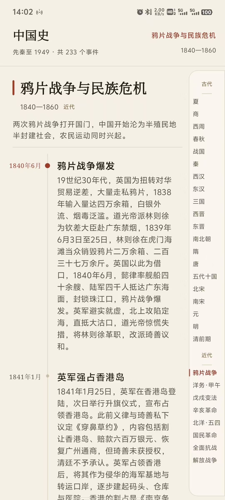

# 历史时间轴

一个纯离线的中国历史竖向时间轴 App：从先秦到 1949 年，按时间顺序自上而下浏览，右侧提供朝代/时期快速定位轴。



## 数据规模

| 分类 | 时期数 | 事件数 |
| --- | --- | --- |
| 古代史（先秦—清前期） | 20 | 131 |
| 近代史（1840—1949） | 8 | 102 |
| 合计 | 28 | 233 |

近代部分按历史教材分期组织，事件时间精确到年月（重要事件到日），战役条目均写明交战方与胜负/意义。

## 侧边朝代轴

古代（20 段）：夏、商、西周、春秋、战国、秦、西汉、东汉、三国、西晋、东晋、南北朝、隋、唐、五代十国、北宋、南宋、元、明、清前期。

近代（8 段）：鸦片战争与民族危机、洋务运动与甲午战争、戊戌变法与义和团运动、辛亥革命与民国建立、北洋军阀与五四运动、国民革命与土地革命、全民族抗战、解放战争。

点击任一段直接定位到该时期起点，当前所在时期高亮跟随。

## 界面

- 单主界面：顶部标题栏 + 竖向时间轴 + 右侧朝代快速轴，无设置页、搜索页与多标签导航。
- `LazyColumn` 虚拟化长列表；朝代标题吸顶，滚动时始终能看清所处时代。
- 事件条目：左侧日期、时间轴节点（重点事件以朱砂色圆点标记）、右侧标题与说明。
- 浅色/深色主题跟随系统。

## 构建

```powershell
.\gradlew.bat :app:assembleDebug :app:assembleRelease
```
